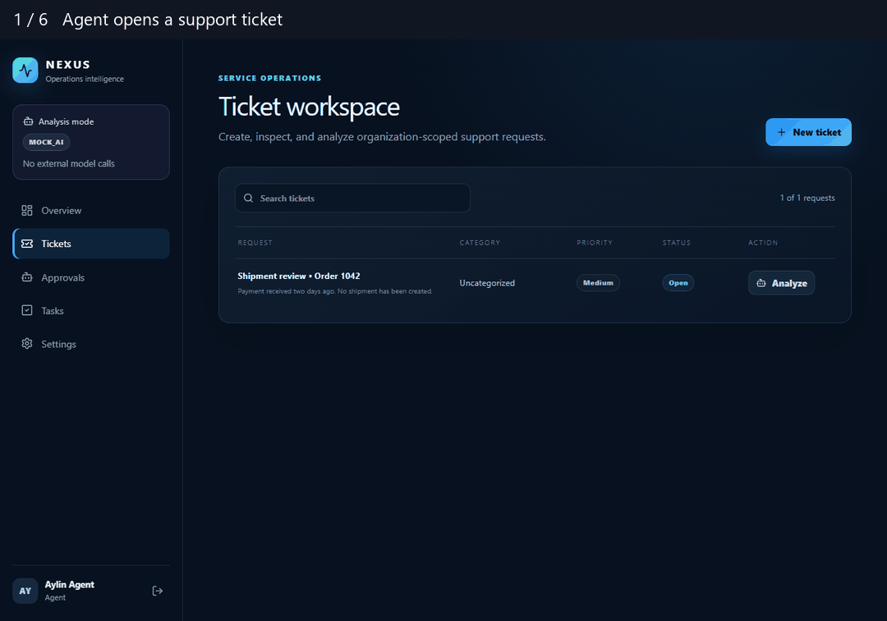

# NEXUS · One ticket, two roles

An Agent opens a ticket for an order that has been paid but has not shipped. The deterministic mock analyzer proposes an internal task for Logistics. What happens if the Agent tries to approve it?

[Download the full browser recording (WebM)](https://raw.githubusercontent.com/ecem-jpg/ecem-jpg/main/nexus-walkthrough.webm)

| Step | What the recording demonstrates |
| --- | --- |
| Agent reviews order 1042 | Approval controls are disabled. During capture, a separate request with the signed-in Agent’s session and CSRF token returned HTTP 403. A query confirmed zero tasks for that suggestion. |
| Manager reviews the same ticket | Approval creates an internal task referencing the source suggestion. The task remains visible after a page reload. |
| Manager opens audit history | The API returns an approval event referencing the same approval ID. |

**Implementation.** React and TypeScript call an ASP.NET Core 10 API. The PostgreSQL implementation uses EF Core migrations. An approval, its task and its audit record are committed together. A version check and a unique constraint on the suggestion protect against duplicate execution.

**Verification.** The recording uses a fresh SQLite demo database with fictional accounts. The Phase 1 verification also ran on PostgreSQL using the same API with a fresh migration and an Edge end-to-end test. The automated .NET suite passed 3 unit tests and 7 integration tests. The analyzer uses fixed local rules and requires no external model or credentials.
